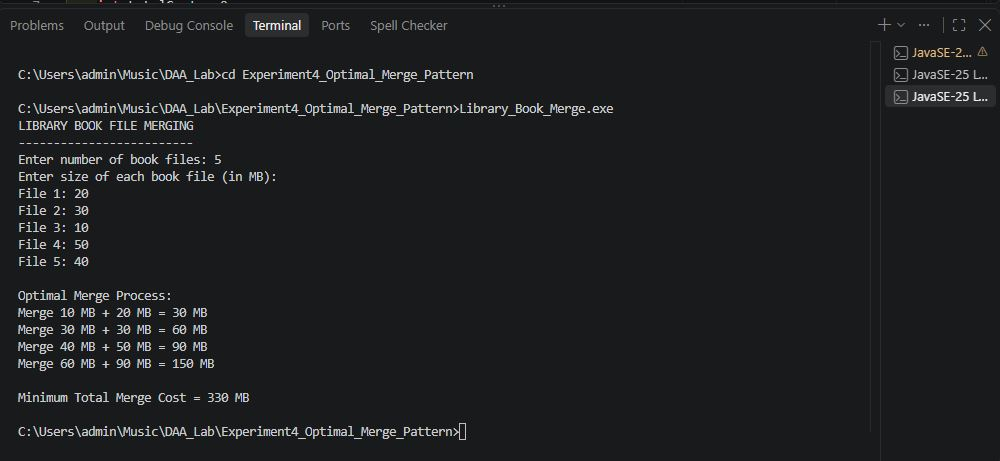
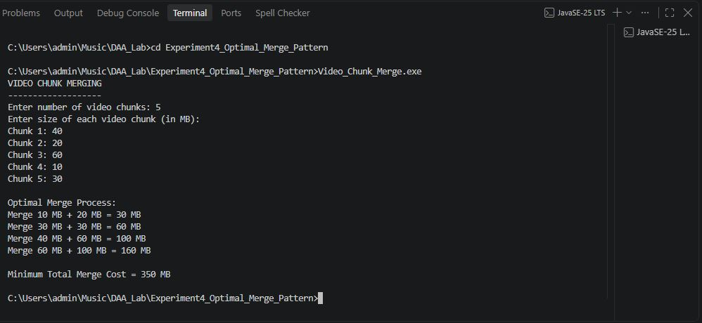
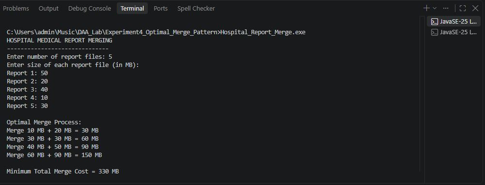

# Experiment No. 4 — Optimal Merge Pattern Using Greedy Method

## Aim

To implement the **Optimal Merge Pattern** using the **Greedy Method** and find the minimum total cost required to merge multiple files.

---

## Objective

* To understand the concept of Optimal Merge Pattern.
* To implement the Greedy Method for file merging.
* To select the two smallest files at every step.
* To calculate the minimum total merge cost.
* To apply the Greedy Method to real-world applications.
* To analyze the time and space complexity.

---

## Theory

The **Optimal Merge Pattern** is a Greedy Method used to merge multiple files with minimum total cost.

At every step, the two files with the smallest sizes are selected and merged. The cost of merging these two files is added to the total cost.

The newly merged file is then added back to the list of files.

This process continues until only one file remains.

### Formula

```text
Merge Cost = Size of File 1 + Size of File 2

Total Merge Cost = Sum of all Merge Costs
```

---

# Applications

### 1. Library Book File Merging

Multiple library book-record files are merged into a single file while minimizing the total file merging cost.

**Source File:** `Library_Book_Merge.c`

### 2. Video Chunk Merging

Small video chunks are merged into a complete video using minimum processing cost.

**Source File:** `Video_Chunk_Merge.c`

### 3. Hospital Medical Report Merging

Medical report files from different departments are merged into a single report file with minimum total merging cost.

**Source File:** `Hospital_Report_Merge.c`

---

# Application 1 — Library Book File Merging

The program merges multiple library book-record files according to their file sizes and calculates the **minimum total merge cost**.

### Algorithm

1. Read the number of book files.
2. Read the size of each book file.
3. Sort the file sizes in ascending order.
4. Select the two smallest files.
5. Merge the two files.
6. Add the merge cost to the total cost.
7. Insert the merged file back into the list.
8. Repeat until only one file remains.
9. Display the minimum total merge cost.

### Source File

`Library_Book_Merge.c`

### Output



---

# Application 2 — Video Chunk Merging

The program merges multiple video chunks according to their sizes and calculates the **minimum processing cost** required to create a complete video.

### Algorithm

1. Read the number of video chunks.
2. Read the size of each video chunk.
3. Sort the chunk sizes in ascending order.
4. Select the two smallest chunks.
5. Merge the two chunks.
6. Add the merge cost to the total cost.
7. Insert the merged chunk back into the list.
8. Repeat until only one video chunk remains.
9. Display the minimum total merge cost.

### Source File

`Video_Chunk_Merge.c`

### Output



---

# Application 3 — Hospital Medical Report Merging

The program merges medical report files from different hospital departments and calculates the **minimum total merging cost**.

### Algorithm

1. Read the number of medical report files.
2. Read the size of each report file.
3. Sort the report sizes in ascending order.
4. Select the two smallest reports.
5. Merge the two reports.
6. Add the merge cost to the total cost.
7. Insert the merged report back into the list.
8. Repeat until only one report remains.
9. Display the minimum total merge cost.

### Source File

`Hospital_Report_Merge.c`

### Output



---

# Time Complexity

The programs sort the file sizes repeatedly during the merging process.

```text
Sorting Time Complexity = O(n²)
Selection Time Complexity = O(n)

Overall Time Complexity = O(n²)
```

---

# Space Complexity

The programs use arrays to store the file sizes.

```text
Space Complexity = O(n)
```

---

# Advantages

* Simple and easy to implement.
* Produces minimum total merge cost.
* Uses the Greedy approach.
* Useful for file merging and data processing applications.
* Can be applied to different real-world file merging problems.

---

# Limitations

* Repeated sorting increases the execution time.
* For very large datasets, a priority queue/min-heap is more efficient.
* The algorithm is mainly useful when the merging cost depends on file size.

---

# Applications

The Optimal Merge Pattern using the Greedy Method can be used in:

* Library Book File Merging
* Video Chunk Merging
* Hospital Medical Report Merging
* File Compression
* Data Processing
* Database File Merging
* External Sorting
* Log File Merging
* Document Processing

---

# Conclusion

The **Optimal Merge Pattern** was successfully implemented using the **Greedy Method**.

Three real-world applications were implemented:

1. Library Book File Merging
2. Video Chunk Merging
3. Hospital Medical Report Merging

The programs select the two smallest files at every step and merge them to obtain the **minimum total merge cost**.

Thus, the **Greedy Method** provides an efficient approach for solving the **Optimal Merge Pattern** problem.
